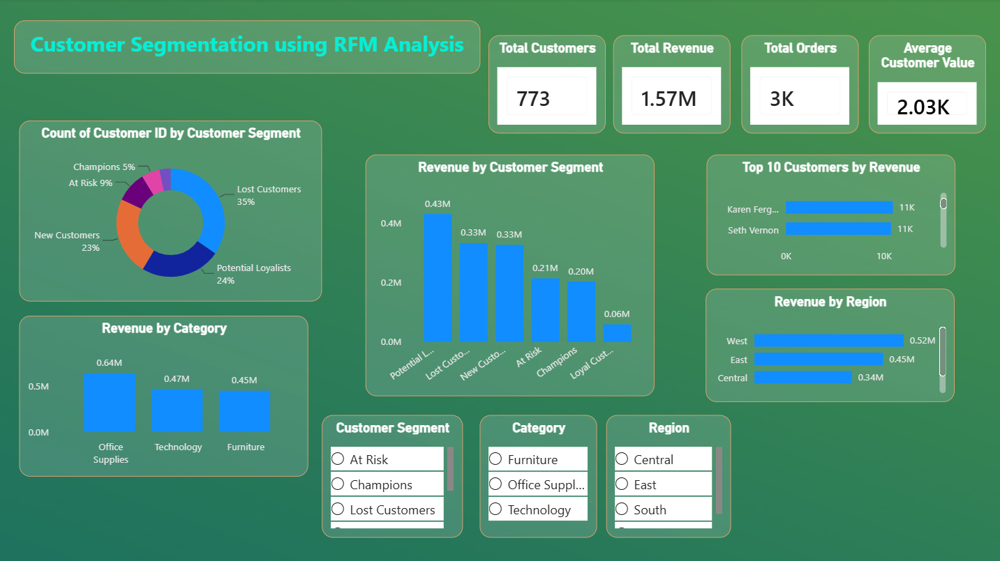

# 📊 Customer Segmentation using RFM Analysis

Interactive Power BI dashboard that segments customers using **Recency, Frequency, and Monetary (RFM)** analysis to help businesses understand customer behavior and support data-driven marketing decisions.

---

## 📸 Dashboard Preview

> Replace the link below after saving the README.

---

# 📌 Project Overview

Customer segmentation is an important business strategy that helps organizations understand different customer groups based on purchasing behavior.

In this project, RFM Analysis was performed on the SuperStore dataset to classify customers into meaningful segments such as Champions, Loyal Customers, Potential Loyalists, At Risk, New Customers, and Lost Customers.

The dashboard enables business users to quickly identify high-value customers, revenue-driving segments, and areas requiring customer retention strategies.

---

# 🎯 Business Problem

The business wanted to answer the following questions:

- Which customer segment generates the highest revenue?
- Which customers are most valuable?
- Which customers are at risk of churn?
- Which region performs the best?
- Which product category generates the highest sales?

---

# 🛠️ Tools & Technologies

- Power BI
- Power Query
- DAX
- Microsoft Excel

---

# 📂 Dataset

**Dataset:** SuperStore Sales Dataset

**Total Customers:** 773

**Analysis Technique:** RFM (Recency • Frequency • Monetary)

---

# 📈 Dashboard Features

- Customer Segmentation using RFM Analysis
- KPI Cards
- Revenue Analysis
- Region-wise Performance
- Category-wise Performance
- Top Customers Analysis
- Interactive Slicers

---

# 📊 Key Business Insights

- Potential Loyalists generated the highest revenue.
- Lost Customers represent the largest customer segment.
- West region generated the highest revenue.
- Office Supplies is the highest revenue-generating category.
- Karon Ferguson is the highest-value customer.

---

# 💡 Business Recommendations

- Convert Potential Loyalists into Loyal Customers using loyalty programs.
- Launch retention campaigns targeting Lost Customers.
- Replicate successful sales strategies from the West region.
- Increase focus on Office Supplies due to strong performance.
- Reward high-value customers with personalized offers.

---

# 🚀 Future Improvements

- Dynamic RFM scoring using quintiles.
- Customer churn prediction.
- Time-series sales analysis.
- Automated data refresh.

---

# 👨‍💻 Author

**Paras Mudgal**

B.Tech (Information Technology)

Aspiring Data Analyst | Power BI | SQL | Excel
